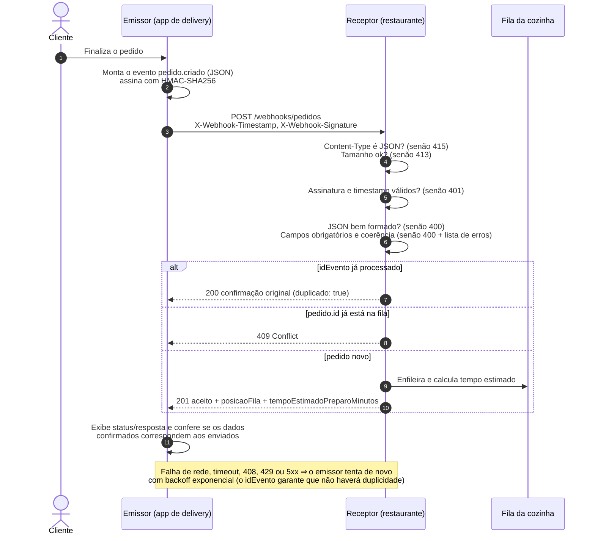

# Webhook Delivery → Restaurante

Atividade prática de **implementação de webhook** (85ESE): duas aplicações Node.js **independentes** que se comunicam por uma **requisição HTTP real com JSON**.

- **Emissor** ([emissor/](emissor/)): o aplicativo de delivery. Quando o cliente finaliza um pedido, ele gera o evento `pedido.criado` e o envia ao restaurante.
- **Receptor** ([receptor/](receptor/)): o sistema do restaurante. Recebe o webhook, valida o pedido, coloca os pedidos válidos na fila da cozinha e responde com uma confirmação e o tempo estimado de preparo.

---

## 1. Cenário

| | |
|---|---|
| **Sistema emissor** | Aplicativo de delivery (marketplace) onde o cliente monta e paga o pedido. |
| **Sistema receptor** | Sistema de gestão do restaurante, responsável pela fila da cozinha. |
| **Evento que dispara o envio** | Um cliente **finaliza um novo pedido** no aplicativo (`pedido.criado`). |
| **Dados transmitidos** | Identificação do evento e do pedido, cliente, **itens** (código, nome, quantidade, preço, observação), **endereço de entrega**, **forma de pagamento** (com troco quando em dinheiro), valores (subtotal, taxa, desconto, total) e **observações** do pedido. |
| **Resposta esperada** | `201` com a posição na fila e o **tempo estimado de preparo**; ou um erro (`400`, `401`, `409`, `413`, `415`, `500`) explicando o motivo. |

Sem o webhook, o restaurante teria que consultar o aplicativo periodicamente (*polling*) para descobrir pedidos novos. Com o webhook, o aplicativo **avisa o restaurante no momento em que o pedido é criado**.

## 2. Fluxo de comunicação



Em texto:

1. O emissor gera o pedido e o organiza no JSON do evento `pedido.criado`.
2. Serializa o JSON e calcula `HMAC-SHA256(segredo, "<timestamp>.<corpo>")`.
3. Faz um `POST` real para `http://<receptor>/webhooks/pedidos` com o corpo e os cabeçalhos de assinatura.
4. O receptor verifica o tipo do conteúdo, o tamanho, a assinatura (antes de interpretar o JSON), interpreta o JSON e valida todos os campos.
5. Se for válido, adiciona o pedido à fila da cozinha, exibe a comanda no console e responde `201` com a confirmação e o tempo estimado.
6. O emissor exibe o status HTTP e a resposta e confere se a confirmação corresponde ao que foi enviado (id do evento, id do pedido, quantidade de itens, total e forma de pagamento).

## 3. Estrutura do projeto

```
.
├── package.json              # workspaces (emissor + receptor) e scripts globais
├── README.md
├── exemplos/
│   ├── pedido-valido.json    # payload de exemplo aceito (201)
│   └── pedido-invalido.json  # payload de exemplo recusado (400)
├── scripts/
│   └── demo.js               # sobe o receptor e roda o emissor em processos separados
├── tests/
│   └── integracao.test.js    # emissor real → receptor real via HTTP + teste de contrato
├── emissor/                  # APLICATIVO DE DELIVERY
│   ├── .env.example
│   ├── src/
│   │   ├── index.js          # CLI: gera/carrega o evento, envia e exibe o resultado
│   │   ├── config.js         # variáveis de ambiente validadas
│   │   ├── catalog.js        # itens do restaurante, clientes de exemplo
│   │   ├── orderFactory.js   # monta o evento pedido.criado (válido ou inválido)
│   │   ├── webhookClient.js  # POST assinado, timeout, retry com backoff
│   │   ├── signature.js      # HMAC-SHA256
│   │   └── receiptCheck.js   # confere a confirmação com o pedido enviado
│   └── test/
└── receptor/                 # SISTEMA DO RESTAURANTE
    ├── .env.example
    ├── src/
    │   ├── server.js         # ponto de entrada (carrega .env, sobe o HTTP, shutdown)
    │   ├── app.js            # monta o Express com injeção de dependências
    │   ├── config/index.js
    │   ├── data/cardapio.js  # itens aceitos e tempo de preparo de cada um
    │   ├── middleware/
    │   │   ├── webhookSecurity.js  # Content-Type, assinatura HMAC, parse do JSON
    │   │   └── errorHandlers.js    # 404 e tratamento centralizado de erros
    │   ├── routes/
    │   │   ├── webhookRoutes.js    # POST /webhooks/pedidos
    │   │   └── kitchenRoutes.js    # GET /cozinha/fila, POST /cozinha/pedidos/:id/pronto
    │   ├── services/
    │   │   ├── orderService.js     # regra de recebimento (validação, idempotência, fila)
    │   │   ├── kitchenQueue.js     # fila FIFO da cozinha
    │   │   ├── prepTimeEstimator.js
    │   │   └── idempotencyStore.js
    │   ├── validation/orderValidator.js
    │   └── utils/ (logger, signature, kitchenTicket)
    └── test/
```

## 4. Instalação

Pré-requisito: **Node.js 20.12 ou superior** (usa `fetch`, `node:test` e `process.loadEnvFile` nativos). Testado com Node 24.

```bash
npm install
```

A única dependência de execução é o **Express** (no receptor). O emissor e os testes usam apenas módulos nativos do Node.

### Configuração (opcional)

Cada aplicação lê um arquivo `.env` em sua pasta. Copie os exemplos e defina o **mesmo** `WEBHOOK_SECRET` nos dois:

```bash
cp receptor/.env.example receptor/.env
cp emissor/.env.example emissor/.env
```

Sem `.env`, ambos usam um segredo de desenvolvimento (com aviso no console) e as portas/URLs padrão. Com `NODE_ENV=production`, o segredo passa a ser obrigatório.

| Variável | Aplicação | Padrão | Descrição |
|---|---|---|---|
| `PORT` | receptor | `3000` | Porta HTTP |
| `WEBHOOK_SECRET` | ambas | segredo de dev | Segredo compartilhado do HMAC |
| `SIGNATURE_TOLERANCE_SECONDS` | receptor | `300` | Janela anti-replay |
| `KITCHEN_STATIONS` | receptor | `2` | Estações de preparo em paralelo |
| `BODY_LIMIT` | receptor | `100kb` | Tamanho máximo do corpo |
| `LOG_LEVEL` | receptor | `info` | `debug`, `info`, `warn`, `error`, `silent` |
| `RECEIVER_URL` | emissor | `http://localhost:3000/webhooks/pedidos` | Endpoint do webhook |
| `REQUEST_TIMEOUT_MS` | emissor | `5000` | Timeout por tentativa |
| `MAX_RETRIES` | emissor | `3` | Novas tentativas em falhas transitórias |
| `RETRY_BASE_DELAY_MS` | emissor | `500` | Atraso base do backoff exponencial |

## 5. Execução (teste de integração manual)

**Terminal 1 — receptor (restaurante):**

```bash
npm run start:receptor
# INFO Restaurante (receptor) ouvindo em http://localhost:3000/webhooks/pedidos
```

**Terminal 2 — emissor (aplicativo de delivery):**

```bash
npm run start:emissor                                         # gera e envia um pedido aleatório
npm run start:emissor -- --repetir                            # envia e reenvia o mesmo evento (idempotência)
npm run start:emissor -- --invalido                           # envia um pedido com erros (400)
npm run start:emissor -- --arquivo ../exemplos/pedido-valido.json
npm run start:emissor -- --ajuda
```

> O caminho de `--arquivo` é relativo à pasta `emissor/`, pois o npm executa o script dentro do workspace. Alternativa: `node emissor/src/index.js --arquivo exemplos/pedido-valido.json` a partir da raiz.

O emissor exibe o **payload enviado**, o **status HTTP**, o **corpo da resposta** e o resultado da conferência dos dados. O terminal do receptor exibe a **comanda** do pedido que entrou na fila. Código de saída do emissor: `0` aceito, `1` recusado/divergente, `2` falha de entrega.

**Demonstração automática** (sobe o receptor e roda o emissor como processos separados, na porta 3999):

```bash
npm run demo
```

### Consultar a fila da cozinha

```bash
curl http://localhost:3000/cozinha/fila
curl -X POST http://localhost:3000/cozinha/pedidos/PED-20261022-104512/pronto   # marca como pronto
curl http://localhost:3000/health
```

## 6. Testes automatizados

```bash
npm test                 # todos: receptor + emissor + integração (66 testes)
npm run test:receptor    # validação, assinatura, fila, API HTTP
npm run test:emissor     # geração do pedido, cliente HTTP (retry/timeout), conferência
```

| Arquivo | O que cobre |
|---|---|
| [receptor/test/orderValidator.test.js](receptor/test/orderValidator.test.js) | Campos obrigatórios, tipos, cardápio, CEP/UF, soma dos valores, regras de pagamento/troco |
| [receptor/test/signature.test.js](receptor/test/signature.test.js) | HMAC, corpo adulterado, segredo errado, replay |
| [receptor/test/kitchenQueue.test.js](receptor/test/kitchenQueue.test.js) | Estimativa de preparo, FIFO, remoção, idempotência com TTL |
| [receptor/test/app.test.js](receptor/test/app.test.js) | Respostas HTTP 200/201/400/401/404/409/413/415/500 |
| [emissor/test/webhookClient.test.js](emissor/test/webhookClient.test.js) | POST real com assinatura, retry em 5xx, sem retry em 4xx, timeout, receptor fora do ar |
| [emissor/test/orderFactory.test.js](emissor/test/orderFactory.test.js) | Coerência dos pedidos gerados |
| [tests/integracao.test.js](tests/integracao.test.js) | **Emissor real → receptor real via HTTP**: 201, dados na cozinha iguais aos enviados, fila, idempotência, 400, 401; contrato com 500 pedidos gerados |

## 7. Contrato do webhook

### Requisição

```
POST /webhooks/pedidos
Content-Type: application/json
X-Webhook-Event: pedido.criado
X-Webhook-Id: <idEvento>
X-Webhook-Timestamp: <unix epoch em segundos>
X-Webhook-Signature: sha256=<hex de HMAC-SHA256(segredo, "<timestamp>.<corpo bruto>")>
```

Corpo ([exemplos/pedido-valido.json](exemplos/pedido-valido.json)):

```json
{
  "evento": "pedido.criado",
  "idEvento": "evt_7b1f6d0e-3c2a-4b8e-9f10-2a6c5d4e3b21",
  "criadoEm": "2026-10-22T19:30:00.000Z",
  "pedido": {
    "id": "PED-20261022-104512",
    "restaurante": { "id": "REST-0042", "nome": "Cantina Sabor da Casa" },
    "cliente": { "nome": "Ana Souza", "telefone": "+55 47 99876-5432" },
    "itens": [
      { "codigo": "PIZZA-002", "nome": "Pizza Calabresa (grande)", "quantidade": 1, "precoUnitario": 62.0, "observacoes": "sem cebola" },
      { "codigo": "PORC-001", "nome": "Batata Frita (porção)", "quantidade": 1, "precoUnitario": 18.0 },
      { "codigo": "BEB-001", "nome": "Refrigerante Lata 350ml", "quantidade": 2, "precoUnitario": 6.5, "observacoes": "bem gelado" }
    ],
    "enderecoEntrega": {
      "logradouro": "Rua XV de Novembro", "numero": "1200", "complemento": "Apto 302",
      "bairro": "Centro", "cidade": "Blumenau", "uf": "SC", "cep": "89010-001", "referencia": "Em frente à praça"
    },
    "pagamento": { "forma": "dinheiro", "pagoOnline": false, "trocoPara": 100.0 },
    "valores": { "subtotal": 93.0, "taxaEntrega": 7.9, "desconto": 5.0, "total": 95.9 },
    "observacoes": "Interfone com defeito, ligar ao chegar."
  }
}
```

### Regras de validação

| Campo | Regra |
|---|---|
| `evento` | Obrigatório, igual a `pedido.criado` |
| `idEvento` | Obrigatório, texto (até 100), usado para idempotência |
| `criadoEm` | Obrigatório, data/hora ISO 8601 |
| `pedido.id` | Obrigatório, texto (até 100) |
| `pedido.cliente.nome` / `.telefone` | Obrigatórios; telefone com 10 a 13 dígitos |
| `pedido.itens[]` | 1 a 50 itens; `codigo` deve existir no cardápio; `quantidade` inteiro 1–99; `precoUnitario` ≥ 0 com até 2 casas; `observacoes` opcional |
| `pedido.enderecoEntrega` | `logradouro`, `numero`, `bairro`, `cidade` obrigatórios; `uf` válida; `cep` `00000-000`; `complemento`/`referencia` opcionais |
| `pedido.pagamento.forma` | `pix`, `cartao_credito`, `cartao_debito`, `dinheiro` ou `vale_refeicao` |
| `pedido.pagamento.pagoOnline` | Booleano obrigatório; `dinheiro` não pode ser `true` |
| `pedido.pagamento.trocoPara` | Opcional; só para `dinheiro` e ≥ total |
| `pedido.valores` | `subtotal` = soma dos itens; `total` = subtotal + taxaEntrega − desconto (comparação em centavos) |
| `pedido.observacoes` | Opcional, até 500 caracteres |

### Respostas

| HTTP | Quando | Corpo |
|---|---|---|
| **201** | Pedido aceito e enfileirado | confirmação (abaixo) |
| **200** | Mesmo `idEvento` reenviado | confirmação original com `"duplicado": true` |
| **400** | JSON malformado ou campos inválidos | `{ status: "rejeitado", mensagem, erros: [{ campo, mensagem }] }` |
| **401** | Assinatura ausente/inválida ou timestamp fora da janela | idem, sem `erros` |
| **404** | Rota inexistente | idem |
| **409** | `pedido.id` já está na fila (com outro `idEvento`) | idem |
| **413** | Corpo maior que `BODY_LIMIT` | idem |
| **415** | `Content-Type` não é `application/json` | idem |
| **500** | Erro inesperado (detalhes só no log) | `{ status: "erro", mensagem }` |

**201 — aceito:**

```json
{
  "status": "aceito",
  "mensagem": "Pedido recebido e adicionado à fila da cozinha",
  "idEvento": "evt_7b1f6d0e-3c2a-4b8e-9f10-2a6c5d4e3b21",
  "pedidoId": "PED-20261022-104512",
  "posicaoFila": 1,
  "tempoEstimadoPreparoMinutos": 31,
  "previsaoPronto": "2026-10-22T23:17:41.178Z",
  "recebidoEm": "2026-10-22T22:46:41.179Z",
  "resumo": { "quantidadeItens": 4, "valorTotal": 95.9, "formaPagamento": "dinheiro" },
  "duplicado": false
}
```

**400 — rejeitado** ([exemplos/pedido-invalido.json](exemplos/pedido-invalido.json)):

```json
{
  "status": "rejeitado",
  "mensagem": "Payload do pedido inválido",
  "erros": [
    { "campo": "pedido.cliente.telefone", "mensagem": "Campo obrigatório" },
    { "campo": "pedido.itens[1].codigo", "mensagem": "Item \"SUSHI-999\" não existe no cardápio do restaurante" },
    { "campo": "pedido.itens[1].quantidade", "mensagem": "Deve ser um inteiro entre 1 e 99" },
    { "campo": "pedido.enderecoEntrega.uf", "mensagem": "Deve ser uma UF brasileira válida (ex.: SC, SP)" },
    { "campo": "pedido.enderecoEntrega.cep", "mensagem": "Deve estar no formato 00000-000" },
    { "campo": "pedido.valores.total", "mensagem": "Deve ser subtotal + taxaEntrega - desconto (esperado 67.70)" },
    { "campo": "pedido.pagamento.trocoPara", "mensagem": "Só é permitido quando a forma de pagamento é dinheiro" }
  ]
}
```

**401 — sem assinatura:**

```bash
curl -i -X POST http://localhost:3000/webhooks/pedidos -H "Content-Type: application/json" -d "{}"
# HTTP/1.1 401 Unauthorized
# {"status":"rejeitado","mensagem":"Cabeçalhos de assinatura ausentes","erros":[]}
```

### Enviando com curl (assinatura manual)

Requisições sem assinatura são recusadas. Para testar com curl/Postman, gere os cabeçalhos com o Node (bash):

```bash
SECRET=segredo-de-desenvolvimento-nao-use-em-producao   # ou o WEBHOOK_SECRET do .env
TS=$(date +%s)
BODY=$(node -e "process.stdout.write(JSON.stringify(require('./exemplos/pedido-valido.json')))")
SIG=$(node -e "const c=require('crypto');process.stdout.write('sha256='+c.createHmac('sha256',process.argv[1]).update(process.argv[2]+'.'+process.argv[3]).digest('hex'))" "$SECRET" "$TS" "$BODY")

curl -i -X POST http://localhost:3000/webhooks/pedidos \
  -H "Content-Type: application/json" \
  -H "X-Webhook-Timestamp: $TS" \
  -H "X-Webhook-Signature: $SIG" \
  --data-raw "$BODY"
```

## 8. Principais decisões de implementação

- **Duas aplicações realmente distintas.** Emissor e receptor ficam em pacotes separados, com configuração própria, e não importam código um do outro; o único acoplamento é o contrato HTTP/JSON. Por isso a função de assinatura existe nos dois lados, de propósito. O monorepo com *npm workspaces* serve apenas para instalar e testar tudo com um comando.
- **Autenticação por HMAC-SHA256 + timestamp** (padrão usado por Stripe, GitHub etc.). A assinatura cobre `timestamp.corpo`, é verificada com `crypto.timingSafeEqual` (comparação em tempo constante) e **antes** do `JSON.parse`, para que conteúdo não autenticado nunca seja interpretado. A janela de 5 minutos impede o reaproveitamento de requisições capturadas (*replay*).
- **Idempotência por `idEvento`.** Webhooks são entregues "pelo menos uma vez": se a resposta se perder, o emissor reenvia. O receptor devolve a confirmação original (`200`, `duplicado: true`) em vez de duplicar o pedido na cozinha. Um `pedido.id` repetido com outro `idEvento` gera `409`.
- **Retry inteligente no emissor.** Repete com backoff exponencial apenas falhas transitórias (rede, timeout, `408`, `429`, `5xx`); erros `4xx` indicam problema no próprio payload e não são repetidos. Cada tentativa é reassinada com um timestamp novo.
- **Validação completa e explicativa.** O validador (sem bibliotecas) coleta **todos** os erros com o caminho do campo, confere a coerência financeira em centavos (evita erros de ponto flutuante) e recusa itens que não estão no cardápio do restaurante.
- **Tempo estimado de preparo.** `tempo = item mais demorado + 1 min por unidade adicional + ⌈soma do preparo dos pedidos à frente ÷ estações⌉`. Os tempos por item ficam em [receptor/src/data/cardapio.js](receptor/src/data/cardapio.js).
- **Camadas e injeção de dependências.** Rotas só traduzem HTTP; a regra de negócio fica em `orderService` (sem dependência do Express); a fila, o armazenamento de idempotência, o relógio e o logger são injetados. Isso torna os testes rápidos e determinísticos.
- **Erros tratados de forma centralizada.** Respostas sempre em JSON com formato consistente; erros internos devolvem `500` genérico sem vazar mensagem/stack; limite de tamanho do corpo; cabeçalhos `nosniff`, `X-Frame-Options`, `Cache-Control: no-store`; `x-powered-by` desativado.
- **Poucas dependências.** Apenas Express. `fetch`, `AbortSignal.timeout`, `node:test`, `parseArgs` e `process.loadEnvFile` são nativos do Node, o que reduz superfície de ataque e manutenção.

## 9. Limitações e ambiguidades

- **Armazenamento em memória.** A fila da cozinha e o registro de idempotência são perdidos ao reiniciar o receptor e não são compartilhados entre instâncias. Em produção, usar um banco (PostgreSQL) ou uma fila (Redis/RabbitMQ).
- **Processamento síncrono.** O receptor processa o pedido antes de responder. Em produção, é comum responder `202` imediatamente e processar de forma assíncrona; aqui optou-se pelo síncrono porque o enunciado pede a confirmação com o tempo estimado na própria resposta.
- **Estimativa simplificada.** Não considera o tempo já decorrido dos pedidos em preparo nem a capacidade real por tipo de item; os pedidos à frente contam com o tempo total de preparo.
- **Rotas da cozinha sem autenticação.** `GET /cozinha/fila` e `POST /cozinha/pedidos/:id/pronto` são operacionais/demonstrativas e deveriam ficar atrás de autenticação ou rede interna.
- **Sem HTTPS.** Em desenvolvimento a comunicação é HTTP. Em produção, o endpoint deve usar TLS (diretamente ou via proxy reverso); o HMAC garante autenticidade e integridade, mas não confidencialidade dos dados do cliente.
- **Emissor como CLI.** O PDF pede uma aplicação que gere e envie o evento e apresente o resultado; o emissor foi feito como linha de comando que simula a finalização de um pedido (dados gerados aleatoriamente ou lidos de arquivo). A requisição HTTP, porém, é **real**.
- **Catálogo duplicado.** O emissor mantém sua cópia dos códigos/preços do cardápio (como um app de delivery sincronizado com o restaurante). O receptor valida só a existência do código, não o preço, pois o app pode aplicar promoções.
- **Janela anti-replay depende dos relógios** dos dois servidores estarem sincronizados (tolerância padrão de 5 minutos).
